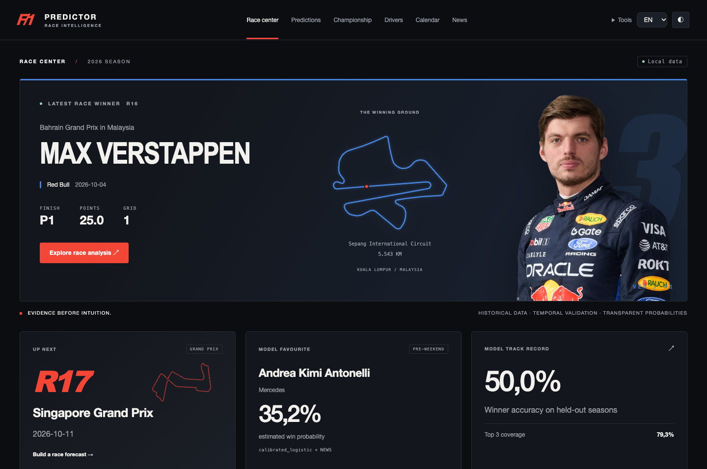
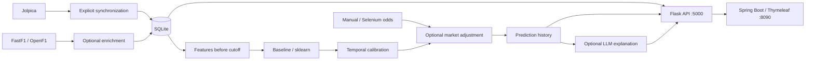

# F1 Predictor

Formula 1 prediction and analytics platform, developed from an ISS university project towards a bachelor thesis. Python owns data and statistics; Spring Boot presents race analysis, transparent forecasts and their measured historical performance.



## What works

- Dynamic current season, last verified race and next scheduled race; generic winner and driver pages.
- Idempotent Jolpica synchronization, preserved historical data, qualifying, sprints, official standings and data-quality reports.
- Pre-weekend and post-qualifying forecasts, calibrated sklearn classifiers, an explicit heuristic baseline and chronological evaluation.
- Seeded Monte Carlo championship simulations, prediction history, retrospective evaluation and CSV exports.
- Manual odds, optional configurable Selenium ingestion, optional OpenAI explanations with a factual fallback.
- Original CRUD REST endpoints, historical import, driver form, regulations, what-if scenarios, dark/light themes and RO/EN navigation and primary labels.

The checked local dataset contains **275 races and 5,457 results across 2014–2026**, as of 8 October 2026. This is a verification snapshot, not a year hardcoded into the application.

## Architecture



The existing Java package remains `com.f1predictor.frontendjava`. There is one frontend under `frontend-java/frontend-java`. Dependencies include Flask, SQLAlchemy, SQLite, pandas, NumPy, SciPy, sklearn, Spring Boot 3.3.5 and Thymeleaf. Java 17+ is required; Java 21 and Python 3.14 were used for local verification. Exact Python package versions are in [VERIFIED_DEPENDENCIES](docs/VERIFIED_DEPENDENCIES.json).

## Run locally

From the repository root, create a Python environment if it does not already exist:

```sh
python3 -m venv backend-python/.venv
backend-python/.venv/bin/python -m pip install -r backend-python/requirements-dev.txt
cp backend-python/.env.example backend-python/.env
backend-python/.venv/bin/python scripts/backup_database.py
backend-python/.venv/bin/python scripts/migrate_database.py
backend-python/.venv/bin/python scripts/sync_f1_data.py --current
```

Do not overwrite an existing `.env`. Skip the backup command on a completely new checkout with no database. Migration automatically backs up an existing database before its first upgrade. The development requirements include optional FastF1/Selenium and tests; use `requirements.txt` for the core runtime only.

Terminal 1, from the repository root:

```sh
backend-python/.venv/bin/python backend-python/app.py
```

Terminal 2:

```sh
cd frontend-java/frontend-java
mvn spring-boot:run
```

Open [F1 Predictor](http://127.0.0.1:8090) and [backend health](http://127.0.0.1:5000/health). Use `127.0.0.1` explicitly on macOS, where AirPlay can also reserve port 5000. Port overrides and troubleshooting are in the [runbook](docs/RUNBOOK.md).

A clean checkout has no generated model. The UI reports an explicit heuristic fallback until training finishes; startup never downloads telemetry or retrains a model.

## Synchronize and train

```sh
backend-python/.venv/bin/python scripts/sync_f1_data.py --from 2014 --to "$(date +%Y)"
backend-python/.venv/bin/python scripts/data_quality_report.py
backend-python/.venv/bin/python scripts/build_training_dataset.py --mode PRE_WEEKEND
backend-python/.venv/bin/python scripts/train_models.py --mode PRE_WEEKEND
backend-python/.venv/bin/python scripts/train_models.py --mode POST_QUALIFYING
```

Training defaults to the last completed calendar year. To reproduce the reported experiment, add `--through-season 2025`. Evaluate an eligible saved historical artifact with:

```sh
backend-python/.venv/bin/python scripts/evaluate_models.py --season 2025 --mode PRE_WEEKEND
```

Generated datasets, joblib models, raw provider caches, database files and backups are excluded by `.gitignore`. Measured evaluation JSON is retained under `docs/evaluation`.

## Method and leakage prevention

Every prediction has a UTC feature cutoff, mode, training cutoff, model version and replay flag. Pre-weekend mode stops before the weekend. Post-qualifying mode uses only qualifying available before the cutoff. Final target-race position, points, status, fastest lap and grid never become pre-race inputs. Regression tests change target/future outcomes and verify identical features and predictions.

Separate logistic classifiers estimate win, podium and top-ten probabilities. A later season calibrates their outputs; winner probabilities are then normalized across the field. The complete distribution is evaluated after normalization. The final ranking uses win probability, so midfield ranking is a known limitation. Explainability factors are observed inputs, not SHAP values or causal effects.

## Actual evaluation

Walk-forward holdouts: **2022–2025, 92 races**. For each test season, the preceding season is reserved for calibration and earlier seasons fit the classifier.

| Mode / model | Winner Top 1 | Winner in Top 3 | Position MAE | Brier | Race log loss |
|---|---:|---:|---:|---:|---:|
| Pre-weekend baseline | 45.65% | 72.83% | 3.894 | 0.03642 | 1.6868 |
| Pre-weekend logistic | **50.00%** | **79.35%** | 3.891 | **0.03415** | **1.6388** |
| Post-qualifying baseline | 53.26% | 81.52% | 3.551 | 0.03247 | 1.4413 |
| Post-qualifying logistic | 51.09% | **85.87%** | **3.272** | **0.03000** | **1.3056** |

ML is not better on every measure: post-qualifying Top 1 is below baseline, and calibration ECE is worse than baseline in both modes. Gradient boosting is benchmarked but was not selected using these test scores. Market-adjusted historical accuracy is **unavailable** without archived pre-race odds. See the [model card](docs/MODEL_CARD.md) for all measured metrics and limitations.

## Data, market and LLM integrations

[Jolpica](https://github.com/jolpica/jolpica-f1/blob/main/docs/README.md) supplies identities, schedules, results, qualifying, sprints and standings, using pagination, retries, caching and atomic upserts. FastF1 enrichment is explicit and cached; it is not currently a model feature. [OpenF1](https://openf1.org/) supplies optional driver portraits/team colours; a local SVG silhouette handles unavailable images.

Manual decimal odds work without Selenium. Optional Selenium providers are public-page configurations with explicit waits, mapping validation, timestamps, caching and `quit()` in `finally`. A real Chrome test passes against a local fixture. **No real bookmaker is configured or claimed verified.** See [odds and Selenium](docs/ODDS_AND_SELENIUM.md).

Optional LLM integration uses the OpenAI Responses API solely to explain computed predictions or confirmed results. Set `LLM_ENABLED`, `OPENAI_API_KEY` and `OPENAI_MODEL` in local `.env`, and install `requirements-llm.txt`. Without credentials, or on failure, deterministic RO/EN text is returned. No live LLM call was tested because no key was available. See [LLM integration](docs/LLM_INTEGRATION.md).

## Verification

```sh
backend-python/.venv/bin/python -m pytest backend-python/tests -q
RUN_SELENIUM=1 backend-python/.venv/bin/python -m pytest backend-python/tests/test_odds_parser.py -q
mvn -f frontend-java/frontend-java/pom.xml test package
backend-python/.venv/bin/python scripts/verify_running_app.py --browser
```

The last command requires both servers and Chrome; it records real smoke-test prediction runs and creates screenshots. Unit tests use an isolated temporary database. Evidence: [E2E report](docs/E2E_VERIFICATION.json), [sync idempotence](docs/SYNC_VERIFICATION.json), [data quality](docs/DATA_QUALITY_REPORT.json).

## Configuration

Core variables: `FLASK_HOST`, `FLASK_PORT`, `DATABASE_URL`, `JOLPICA_BASE_URL`, `HTTP_TIMEOUT_SECONDS`, `PREDICTION_MODE`, `RANDOM_SEED`, `CHAMPIONSHIP_SIMULATIONS`, `MARKET_ENABLED`, `MARKET_WEIGHT`, `SELENIUM_ENABLED`, `ODDS_SOURCES`, `LLM_ENABLED`, `OPENAI_MODEL`, `OPENAI_API_KEY`, `ADMIN_TOKEN`.

Frontend: `SERVER_PORT` (8090), `SERVER_ADDRESS` (127.0.0.1), `FLASK_API_BASE_URL` (http://127.0.0.1:5000), `ADMIN_TOKEN`. Never commit `.env`, credentials or browser cookies.

## Screenshots and documentation

[Desktop](docs/screenshots/dashboard-desktop.png) · [Light theme](docs/screenshots/dashboard-light.png) · [Mobile](docs/screenshots/dashboard-mobile.png) · [Prediction page](docs/screenshots/predictions.png)

[Initial audit](docs/CURRENT_STATE_AUDIT.md) · [Architecture](docs/ARCHITECTURE.md) · [Data pipeline](docs/DATA_PIPELINE.md) · [Prediction methodology](docs/PREDICTION_MODEL.md) · [API](docs/API.md) · [Runbook](docs/RUNBOOK.md) · [Romanian thesis notes](docs/THESIS_NOTES.md) · [Implementation report](docs/IMPLEMENTATION_REPORT.md)

## Limits and thesis scope

This is a local research application, not a production multi-user service. Historical data contains final corrections and reconstructed rosters, not a complete archive of what was published at each historical timestamp. No learned practice, weather, telemetry, tyre strategy, safety-car or future car-development model is claimed. Championship assumptions and what-if interventions are documented, not presented as causal knowledge. Primary UI labels and navigation support RO/EN; some explanatory and administrative text remains English. CSV/TXT exports are implemented; PDF is a future extension. The thesis contribution is a reproducible, auditable temporal pipeline and honest comparative evaluation.

### Circuit calendar and automatic news

The UI includes a circuit atlas, high-resolution official driver portraits and a News page. Upcoming calendar events appear first, chronologically; completed events are grouped below. News uses Selenium to collect public Formula 1 articles every 30 minutes while Flask runs, and a compact local Ollama model creates short attributed summaries. Confirmed race-specific penalties can apply a dated, bounded **experimental** adjustment to race and championship forecasts. Official points are unaffected.

See [News setup and methodology](docs/NEWS_PIPELINE.md), [UI and image sources](docs/UI_ASSETS.md), and [the runbook](docs/RUNBOOK.md). No paid LLM key is required for News.

### Update weekend and Sprint prediction

Predictions → **Update weekend** fetches the official schedule and published FP1/FP2/FP3, Sprint Qualifying, Sprint and GP Qualifying/grid classifications. It saves versioned observations and recalculates separate Grand Prix/Sprint estimates and the championship, then reloads the result automatically. Sprint expected points use the top-eight scoring system; confirmed sprint points enter standings once. See [LIVE_WEEKEND.md](docs/LIVE_WEEKEND.md) for the explicit experimental weighting, timestamps, source availability and verification.


## Free Race Control

Live public timing and complete historical replay now have a dedicated viewer at `/race-control`, including a separate window. No paid subscription is used. Public live position / car channels can be unavailable; completed-session replay includes measured positions and telemetry. See [docs/RACE_CONTROL.md](docs/RACE_CONTROL.md) for availability, sources, timestamps and verification.


Race Control now includes continuous replay through qualifying intermissions, smooth measured markers / labels, tyre-set and incident panels, and an experimental on-track winner forecast. [Details and verification](docs/RACE_STRATEGY.md). The frame endpoint accepts a bounded `window` in seconds for high-speed replay and includes `race_forecast`, `incidents`, `tyre_estimate` and reported component states.

## Manual session update

Tools → **Update all sessions** checks the current weekend's schedule and published results, recalculates the existing forecasts and downloads every available public replay. Progress and source warnings appear in a dialog; replays open the original Race Control viewer. The action is independent of the removed data-platform and OCR extensions. See [docs/SESSION_REFRESH.md](docs/SESSION_REFRESH.md).

## Race Control feed integration

The same viewer now has **Feed diagnostics**, strict session identity/source freshness, bounded reconnect/decoding/state recovery, a measured FastF1 historical fallback, RPM where actually available, observed pit/stint details and read-only provisional driver/constructor championship projections. A connected socket or undated snapshot is not labelled LIVE. Removed OCR/data-platform pages remain absent. Current verification received post-session public timing snapshots but no Position.z/CarData.z; active live GPS/telemetry is still pending a genuine running-session test.

[Full integration report, including the 30 requested answers](docs/LIVE_INTEGRATION_REPORT.md) · [source comparison](docs/LIVE_PROVIDER_COMPARISON.md) · [architecture](docs/LIVE_DATA_ARCHITECTURE.md) · [diagnostics / next-session validation](docs/LIVE_DIAGNOSTICS.md) · [limits](docs/LIVE_LIMITATIONS.md) · [historical strategy benchmark](docs/LIVE_BACKTESTING.md).

```sh
backend-python/.venv/bin/python scripts/verify_timing_integration.py
backend-python/.venv/bin/python scripts/verify_timing_buffers.py
backend-python/.venv/bin/python scripts/backtest_race_strategy.py --download
# Substitute the actual next race ID and session code; stop the app's live feed first.
backend-python/.venv/bin/python scripts/verify_live_sources.py --race-id 210 --session R --public-probe --seconds 20 --compare-public-hosts
```

The existing experimental strategy formula remains unchanged. Its small four-session benchmark underperformed a current-leader baseline; these metrics are reported separately and do not imply a calibrated live model.

## Live Data v2 completion
Live Data v2 extends the existing Race Control diagnostics/projection. The completion evidence is in [docs/LIVE_COMPLETION_REPORT.md](docs/LIVE_COMPLETION_REPORT.md). Active-session Position.z/CarData.z access remains PENDING_LIVE_SESSION; replay and protocol fixtures are reported separately. Tools Update all sessions is retained.

With Flask/Spring Boot running:

```sh
backend-python/.venv/bin/python -m pytest backend-python/tests -q
mvn -f frontend-java/frontend-java/pom.xml test package
node --test scripts/tests/race-control-engine.test.js
backend-python/.venv/bin/python scripts/verify_race_control.py
backend-python/.venv/bin/python scripts/verify_timing_integration.py
backend-python/.venv/bin/python scripts/verify_live_completion_browser.py
backend-python/.venv/bin/python scripts/verify_fastf1_archive.py --browser
backend-python/.venv/bin/python scripts/backtest_race_strategy.py
backend-python/.venv/bin/python scripts/verify_live_performance.py
```

An actual future session requires selecting its catalog race/session code and running `scripts/verify_live_sources.py --race-id <id> --session <code> --public-probe --seconds 30` while it is running, with other app live connections stopped. This is an explicit probe, not an authenticated or protected-content workaround.
