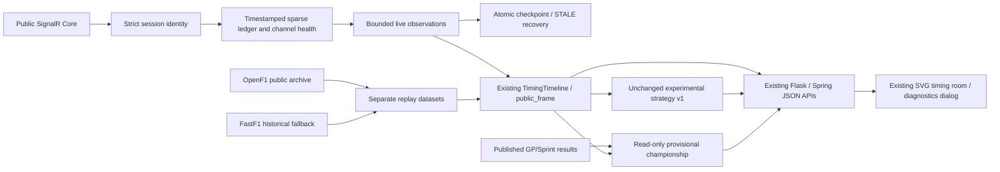

# Existing Race Control: source composition

`timing_contract.py` owns identity validation, leaf provenance, decoding, settings and diagnostics. `PublicTimingFeed` composes the SignalR library handshake/parser/heartbeat with timed public negotiation and a bounded supervisor. `race_control_sources.py` declares roles and supplies a real FastF1 historical converter; it does not pretend every source can stream every channel. The source catalog exposes actual roles separately from observations.

`RaceControlService.live_datasets` and historical `datasets` cannot overwrite each other for the same key. The original renderer and its measured interpolation remain. The live cutoff is server UTC now; map drawing alone uses a three-second interpolation buffer. Historical replay can return real look-ahead positions for drawing, but model inputs are filtered to the replay cutoff. No historical samples are filled into a missing live position/car channel. Previous-session geometry in the same meeting is a static reference, not live location evidence.

A process shares one connection for each selected session across tabs/popouts. A third concurrently selected live session stops the oldest of the two prior active connections. Failed access or retry exhaustion requires explicit user retry. Process exit stops transports. Polling remains at approximately 1.3 seconds; an additional SSE server is not justified by measured local performance and `LIVE_SSE_ENABLED=true` is rejected explicitly.

The database remains schema version 3. No removed OCR/data-platform table or route is restored. Compact bounded gzip checkpoints serve current-state recovery; original archive caches remain separate. “Update all sessions” continues through its independent existing service.

The in-race strategy formula, Monte Carlo draws, pit multipliers and version remain unchanged. The integration supplies real observed laps/pits/stints/flags, explicit missing-input coverage and channel quality. A stale/waiting live feed pauses the probability panel. This model is experimental; evaluation results belong to its own report, not the original pre-race ML accuracy badge.

## Live Data v2 completion
The original 1.3-second polling frame now accepts `scoring=FULL_DISTANCE|STOPPED_NOW` through Flask and the existing Java same-origin proxy. Frame diagnostics and projection are reused without extra periodic calls. Browser requests time out at 20 seconds, are invalidated by session generations and are aborted on pagehide. Backend connections are shared per session; closing one viewer does not stop another viewer. Explicit Stop stops the shared feed. No SSE transport was added.

`race_control_results.py` is a consumed evidence helper for projections and final transitions, not a provider. Existing weekend snapshots now version Jolpica GP/Q/Sprint changes with real local observation UTC. No schema migration or new data-platform subsystem is needed. See [audit](LIVE_COMPLETION_AUDIT.md).
